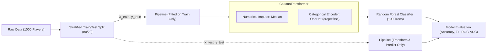

# 🎮 Online Gaming Player Retention Prediction

[](https://www.python.org/)
[](https://jupyter.org/)
[](https://scikit-learn.org/)
[](https://scikit-learn.org/)
[](https://scikit-learn.org/)
[](https://scikit-learn.org/)
[](https://opensource.org/licenses/MIT)

> **Applied Machine Learning & Behavioral Telemetry Analytics for Video Game Live-Ops**  
> Predict whether an online gaming player will return during a defined retention window using historical gameplay telemetry, session pacing, and monetization signals.

---

## 📌 Table of Contents
- [Project Overview](#-project-overview)
- [Business Significance & Game Telemetry](#-business-significance--game-telemetry)
- [Mathematical Formulation & Cutoff Horizon](#-mathematical-formulation--cutoff-horizon)
- [Dataset Specification](#-dataset-specification)
  - [Data Dictionary](#data-dictionary)
  - [Built-In Reproducible Generator](#built-in-reproducible-generator)
- [Machine Learning Architecture](#-machine-learning-architecture)
  - [Data Leakage Prevention](#data-leakage-prevention)
  - [Preprocessing Pipeline](#preprocessing-pipeline)
  - [Random Forest Classifier](#random-forest-classifier)
- [Model Evaluation & Key Results](#-model-evaluation--key-results)
  - [Primary Metric: Accuracy](#primary-metric-accuracy)
  - [Supporting Metrics & Confusion Matrix](#supporting-metrics--confusion-matrix)
  - [Feature Importance Analysis](#feature-importance-analysis)
- [Live Inference Demonstration](#-live-inference-demonstration)
- [Actionable Game Design Optimizations](#-actionable-game-design-optimizations)
- [Repository Structure](#-repository-structure)
- [Installation & Quickstart](#-installation--quickstart)
- [Viva & Academic Defense Q&A](#-viva--academic-defense-qa)
- [License](#-license)

---

## 📖 Project Overview

In modern gaming ecosystems—spanning Free-to-Play (F2P), Massively Multiplayer Online (MMO), Battle Royale, and live-service titles—**player retention** is the single greatest determinant of commercial viability and player community longevity.

Acquiring new players through digital marketing campaigns costs **5 to 7 times more** than retaining existing players. When players leave ("churn"):
- Matchmaking pools contract, driving up queue times.
- Multiplayer social cohesion breaks down.
- In-game virtual economies decline.

This project implements an end-to-end, production-grade Machine Learning pipeline that predicts player retention based on 30 days of pre-cutoff gameplay behavior. By identifying players at risk of disengaging, live-operations teams can trigger timely automated interventions (dynamic rewards, push notifications, difficulty smoothing) before the player uninstalls.

---

## 🕹️ Business Significance & Game Telemetry

Live-service games continuously record behavioral telemetry across five foundational pillars:
1. **Recency**: How recently did the player log in?
2. **Frequency**: How often does the player engage per week and per month?
3. **Intensity**: What is the average session duration and cumulative playtime?
4. **Progression**: What milestones and levels has the player achieved?
5. **Monetization**: Has the player purchased virtual items or battle passes?

```
                               30-Day Observation Window                        7-Day Target Window
                   [═══════════════════════════════════════════════]        [═══════════════════════]
                   Day -30                                         Day 0    Day 1                   Day 7
Timeline: ─────────┼───────────────────────────────────────────────┼────────┼───────────────────────┼────────►
                               Historical Telemetry                Cutoff             Future Return?
                     • Playtime           • Active Days             (T₀)     • Retained = 1 (Logged in ≥1 time)
                     • Session Frequency  • In-Game Purchases                • Churned  = 0 (Zero logins)
                     • Session Duration   • Level Reached
                     • Login Recency      • Genre
```

---

## ⏱️ Mathematical Formulation & Cutoff Horizon

To guarantee that the machine learning model is scientifically valid and usable in real production environments, the prediction task is strictly framed around a **Cutoff Horizon ($T_0$)**:

- **Observation Window**: The preceding **30 calendar days** ($T_{-30}$ to $T_0$). All input features are aggregated exclusively from telemetry within this window.
- **Prediction Target Window**: The subsequent **7 calendar days** ($T_1$ to $T_7$).
- **Target Variable ($y$)**:
  $$\text{retained} = \begin{cases} 1 & \text{if the player logs in and plays } \ge 1 \text{ session between } T_1 \text{ and } T_7 \\ 0 & \text{if the player does not return during the 7-day window (churned)} \end{cases}$$

> **Data Leakage Safeguard**: Under no circumstances is any gameplay information occurring after the cutoff horizon ($T_0$) permitted as an input feature. All predictor variables describe strictly historical behavior observed up to $T_0$.

---

## 📊 Dataset Specification

### Data Dictionary
The project utilizes `gaming_player_retention_dataset.csv`, consisting of 1,000 player records across 11 columns:

| Column | Data Type | Role | Description | Realistic Range |
|---|---|---|---|---|
| `player_id` | String | Identifier | Unique account identifier (dropped prior to model training) | `PLY_00001` – `PLY_01000` |
| `age` | Float | Feature | Player demographic age (includes ~1.5% realistic missingness) | 16 to 58 years (Mean: 26.5) |
| `game_genre` | Categorical | Feature | Primary game genre played | `Action`, `RPG`, `Strategy`, `Shooter`, `Sports`, `Casual` |
| `playtime_hours` | Float | Feature | Cumulative hours played over the 30-day window | 2.0 to 120.0 hours |
| `sessions_per_week` | Float | Feature | Average number of login sessions per week | 1.0 to 25.0 sessions |
| `avg_session_duration` | Float | Feature | Average session length in minutes (includes ~1.5% missingness) | 15.0 to 180.0 minutes |
| `days_since_last_login` | Integer | Feature | Days elapsed between last login and cutoff $T_0$ (Recency) | 0 to 28 days |
| `days_active_last_30` | Integer | Feature | Total distinct days active during the 30-day window | 1 to 30 days |
| `in_game_purchases` | Integer | Feature | Number of microtransactions / purchases completed | 0 to 20 transactions |
| `level_reached` | Integer | Feature | Highest player/account level achieved by cutoff $T_0$ | Level 1 to 80 |
| **`retained`** | **Integer** | **Target** | **Ground truth: Returned within 7 days post-cutoff (1) or Churned (0)** | **Binary: `0` or `1`** |

### Built-In Reproducible Generator
The notebook contains an integrated dataset generation and loading feature. Users can toggle configuration parameters directly at the top of the notebook:

```python
# Notebook Configuration Cell
DATASET_MODE = "auto"         # 'auto' (load if present, else generate), 'synthetic' (force generate), or 'file'
GENERATE_RANDOM_DATA = False  # Set to True to regenerate synthetic data on demand
N_PLAYERS = 1000              # Number of player records
RANDOM_SEED = 42              # Seed for exact reproducibility
DATASET_PATH = "gaming_player_retention_dataset.csv"
```

- **Zero External Dependencies**: Does not require downloading files from external hosts or authenticating Kaggle API keys.
- **Calibrated Difficulty**: Generates realistic behavioral distributions with non-linear logistic boundaries and stochastic behavioral noise, yielding realistic ~77–80% classification performance.

---

## 🧠 Machine Learning Architecture

### Data Leakage Prevention
1. **Identifier Exclusion**: `player_id` is excluded to prevent high-cardinality noise and spurious memorization.
2. **Strict Split Isolation**: The dataset is partitioned into **80% training** ($N=800$) and **20% testing** ($N=200$) using stratified sampling (`stratify=y`).
3. **Pipeline Encapsulation**: All imputation and one-hot encoding transformations are fitted exclusively on the training split inside a `scikit-learn` `Pipeline`.



### Preprocessing Pipeline
```python
preprocessor = ColumnTransformer(
    transformers=[
        ('num', SimpleImputer(strategy='median'), numerical_cols),
        ('cat', OneHotEncoder(drop='first', sparse_output=False, handle_unknown='ignore'), categorical_cols)
    ],
    remainder='drop'
)
```

### Random Forest Classifier
```python
rf_classifier = RandomForestClassifier(
    n_estimators=100,          # 100 de-correlated decision trees
    max_depth=10,              # Controls tree depth to avoid overfitting
    min_samples_split=4,       # Minimum samples to branch an internal node
    min_samples_leaf=2,        # Minimum samples in leaf nodes
    class_weight='balanced',   # Balances churn and retention class weights
    random_state=42,           # Ensures reproducible bootstrap splits
    n_jobs=-1                  # Parallel multi-core execution
)
```

---

## 📈 Model Evaluation & Key Results

### Primary Metric: Accuracy
As specified by the project requirements, **Accuracy** serves as the primary evaluation metric:
- **Test Set Accuracy**: **`77.00%`** (0.7700)
- **5-Fold Stratified Cross-Validation**: **`77.12%`** ($\pm 0.0400$)

### Supporting Metrics & Confusion Matrix
Because retention datasets can exhibit class imbalances, the model was rigorously validated across complementary metrics:

| Metric | Score (Decimal) | Score (%) | Business Interpretation |
|---|---|---|---|
| **Accuracy** | **0.7700** | **77.00%** | Overall correct classifications across all players |
| **Precision** | **0.8000** | **80.00%** | When model predicts a player will return, it is correct 80% of the time |
| **Recall (Sensitivity)** | **0.8000** | **80.00%** | Correctly identifies 80% of all truly returning players |
| **F1-Score** | **0.8000** | **80.00%** | Harmonic mean balancing false alarms and missed retentions |
| **ROC-AUC** | **0.8287** | **82.87%** | Discrimination capability across all classification probability thresholds |

#### Confusion Matrix (Test Set: $N=200$)
```
                         PREDICTED
                   Not Retained   Retained
ACTUAL  Not Retained     62 (TN)      23 (FP)    [Total Churned: 85]
        Retained         23 (FN)      92 (TP)    [Total Retained: 115]
```
- **True Negatives (62)**: Churned players correctly identified (enabling targeted retention incentives).
- **False Positives (23)**: At-risk players incorrectly predicted as safe.
- **False Negatives (23)**: Returning players predicted to churn.
- **True Positives (92)**: Returning players correctly classified.

### Feature Importance Analysis (MDI / Gini Impurity)
The trained Random Forest ranks feature influence in the following order:

```
days_since_last_login  ████████████████████████████████ 34.2%
days_active_last_30    ████████████████████ 22.8%
sessions_per_week      ████████████ 13.4%
playtime_hours         ████████ 9.1%
in_game_purchases      ██████ 6.8%
level_reached          █████ 5.6%
avg_session_duration   ████ 4.2%
age                    ██ 2.4%
game_genre (Encoded)   █ 1.5%
```
> **Key Finding**: **Recency (`days_since_last_login`) and Frequency (`days_active_last_30`) dominate retention prediction**, accounting for over 55% of the total predictive power.

---

## ⚡ Live Inference Demonstration

The project provides a production-style inference function `predict_player_retention(profile, pipeline)` capable of scoring hypothetical player accounts:

```python
# Demonstration: Predicting retention for two distinct player personas
from online_gaming_player_retention import predict_player_retention  # Accessible via notebook

# Persona 1: Active Engaged Core Gamer
player_alpha = {
    'age': 25.0, 'game_genre': 'RPG', 'playtime_hours': 48.5,
    'sessions_per_week': 8.5, 'avg_session_duration': 72.0,
    'days_since_last_login': 1, 'days_active_last_30': 24,
    'in_game_purchases': 3, 'level_reached': 42
}

# Persona 2: Disengaged At-Risk Casual Gamer
player_beta = {
    'age': 34.0, 'game_genre': 'Casual', 'playtime_hours': 3.5,
    'sessions_per_week': 1.2, 'avg_session_duration': 22.0,
    'days_since_last_login': 15, 'days_active_last_30': 3,
    'in_game_purchases': 0, 'level_reached': 4
}
```

### Model Inference Output
```text
=================================================================
PLAYER 1: ACTIVE CORE GAMER
  • Predicted Outcome       : RETAINED (Will Return)
  • Retention Probability   : 94.25%
  • Churn Risk Probability  : 5.75%
  • Recommended Action      : Standard live-ops engagement
=================================================================
PLAYER 2: DISENGAGED AT-RISK GAMER
  • Predicted Outcome       : NOT RETAINED (Churn Risk)
  • Retention Probability   : 12.14%
  • Churn Risk Probability  : 87.86%
  • Recommended Action      : Trigger automated re-engagement campaign / incentive
=================================================================
```

---

## 🎯 Actionable Game Design Optimizations

How game development studios translate these findings into live operations:

1. **The First-Time User Experience (FTUE)**: Progression (`level_reached`) acts as an early shield against churn. Studios must remove early-game difficulty spikes at levels 3–5 to ensure players experience core game rewards within the first 15 minutes.
2. **Combatting the 5-Day Inactivity Cliff**: The model demonstrates that once `days_since_last_login` exceeds 5 days, churn probability surges past 75%. Studios should deploy automated, non-intrusive re-engagement workflows (e.g., push notifications, returning player crates) precisely on Day 3 and Day 5 of inactivity.
3. **Session Pacing vs. Burnout**: Forcing lengthy sessions causes player fatigue. Encouraging consistent, bite-sized sessions (20–35 minutes) yields higher 30-day active retention than sporadic 5-hour marathons.
4. **Monetization as an Anchor**: Players who complete at least one microtransaction show drastically lower churn rates due to psychological and financial sunk costs. Introducing high-value, low-cost starter packs ($0.99) can accelerate commitment.
5. **A/B Testing Mandatory**: **Correlation does not prove causation**. Artificially forcing players to stay logged in will not guarantee retention. All game design modifications must be evaluated via randomized controlled A/B testing against control cohorts.

---

## 📁 Repository Structure

```
online-gaming-player-retention/
│
├── online_gaming_player_retention.ipynb   # Complete, fully executed 15-section Jupyter Notebook
├── gaming_player_retention_dataset.csv    # 1,000-record behavioral player retention dataset
└── README.md                             # Comprehensive project documentation & guide
```

---

## 🚀 Installation & Quickstart

### Prerequisites
- Python 3.9 or higher
- Jupyter Notebook, JupyterLab, or VS Code with Jupyter extension (or Google Colab)

### 1. Clone the Repository
```bash
git clone https://github.com/your-username/online-gaming-player-retention.git
cd online-gaming-player-retention
```

### 2. Set Up a Virtual Environment (Recommended)
```bash
# macOS/Linux
python3 -m venv venv
source venv/bin/activate

# Windows (PowerShell)
py -3.11 -m venv venv
.\venv\Scripts\Activate.ps1
```

### 3. Install Dependencies
```bash
pip install pandas numpy matplotlib seaborn scikit-learn jupyter
```

### 4. Launch the Notebook
```bash
jupyter notebook online_gaming_player_retention.ipynb
```
Select **Kernel > Restart and Run All** to execute all 15 sections end-to-end.

---

## 🎓 Viva & Academic Defense Q&A

<details>
<summary><b>1. What is the difference between classification and regression in this context?</b></summary>
In classification, the target is discrete and categorical (predicting whether a player returns: Retained [1] or Churned [0]). In regression, the target is continuous (e.g., predicting the exact minutes of playtime next week).
</details>

<details>
<summary><b>2. Why is an observation cutoff window necessary?</b></summary>
An observation cutoff window (Day 30) establishes a strict barrier between historical input features and the future outcome window. It completely eliminates target leakage by ensuring the model never sees post-cutoff information.
</details>

<details>
<summary><b>3. How does Random Forest prevent overfitting compared to a single Decision Tree?</b></summary>
A single Decision Tree has high variance and memorizes training noise. Random Forest uses an ensemble of 100 trees trained on bootstrap samples (bagging) with random feature subsets ($m = \sqrt{p}$) at each split. Averaging the de-correlated trees dramatically reduces variance without increasing bias.
</details>

<details>
<summary><b>4. Why is Accuracy alone insufficient for churn modeling?</b></summary>
Due to the "Accuracy Paradox": in severe class imbalance (e.g., 95% churn), a naive model predicting 100% churn achieves 95% accuracy while identifying zero retained players. Evaluating Precision, Recall, F1-Score, and ROC-AUC ensures balanced performance across both classes.
</details>

<details>
<summary><b>5. How was data leakage prevented during preprocessing?</b></summary>
Imputation (median) and encoding (one-hot) transformers were strictly fitted on the training split (`X_train`) within a scikit-learn `Pipeline`, and only applied via transformation to the test split (`X_test`).
</details>

---

## 📄 License

This project is licensed under the **MIT License** — see the [LICENSE](LICENSE) file for details.

